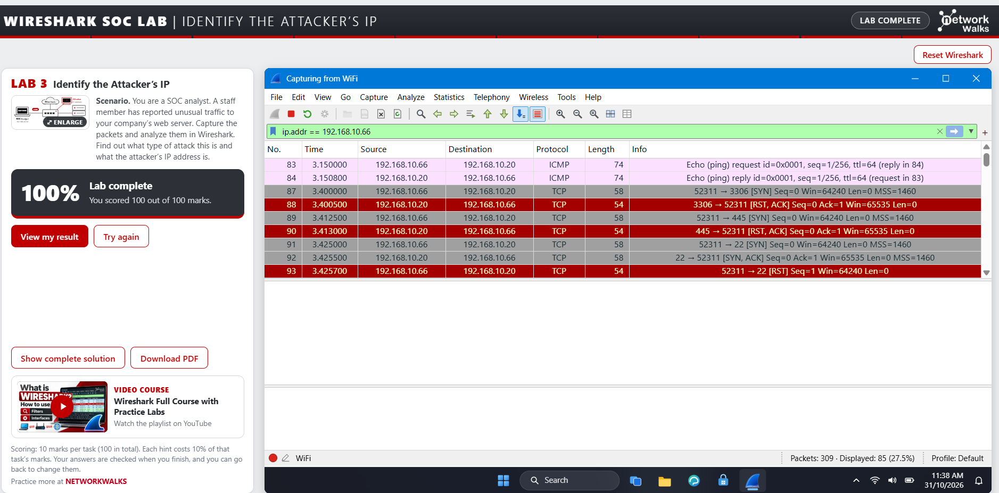

# Networkwalks-B084-week1-Cybersecurity-Extra
Wireshark analysis 

# 🔐 Working with Wireshark

**Building an isolated virtual lab for penetration testing and ethical hacking practice**

  
  
  
  
  
  
  
  
  
  
  

---

## 📌 Project Overview

This project focuses on using **Wireshark** to inspect live packet captures and investigate six network-security scenarios as follows:

- Identify the suspected attacker's IP address.
- Follow a TCP stream to read a chat.
- Follow a TCP stream to uncover a hidden data.
- Identify credentials transmitted in HTTP plaintext.
- Detect a brute-force attack.
- Investigate a phone call conversation.

---

## 🎯 Objectives

The main objectives of this project are to:

- Identify potential attackers.
- Understand network communication.
- Identify security vulnerabilities.
- Detect brute-force attacks.
- Investigate suspicious activities.

---

## 🛡️ Purpose of the Lab 

This lab provides gain hands-on experience in network traffic analysis and cybersecurity investigation using **Wireshark**. The lab focuses on examining captured network packets to identify suspicious IP addresses, analyse TCP communication streams, detect plaintext credential exposure, recognise potential brute-force attacks and investigate network indicators associated with a phone.

Furthermore, the lab aims to strengthen practical knowledge of network protocols, identify common security vulnerabilities, understand potential cyber threats and develop the ability to analyse network-based evidence. It also provides exposure to fundamental security monitoring and incident investigation techniques that are relevant to real-world SOC.

---

## 🔍 SOC Scenario

## 1. Identify the Attacker's IP 

Finding the type of attack and the attacker's IP address.

## Investigation Summary

- Attacker:      192.168.10.66
- Target:        Web server 192.168.10.20
- Ports tried:   40 (open: 22, 80, 443; closed: 37, reply RST, ACK) 
- Attack type:   Port scan

---

## 2. Follow TCP Stream 1

Following TCP Stream to read a chat.

## Investigation Summary

- Chat:        192.168.10.45 to server 192.168.10.20
- TCP port:    5000  
- Shared:      Temporary password and guest Wi-Fi password

---

## 3. Follow TCP Stream 2

Following TCP Stream to find a hidden text.

## Investigation Summary

- Hidden note page:      /staff.html
- Hidden text:           HTML comment from server to client
- Code word:             Falcon-9921 
- Backup server:         192.168.10.77

---

## 4. HTTP plain text credentials.

Finding what can be read from a sign-in that is not encrypted.

## Investigation Summary

- Protocol:      HTTP, POST /login
- User and PC:   farhan.k from 192.168.10.45
- Logins:        2 (1 failed, 1 worked) 
- Password:      Mango#2026

---

## 5 Catch the Brute Force Attacker

Finding who is guessing passwords. 

## Investigation Summary

- Attacker:      192.168.10.66
- Target:        FTP server 192.168.10.20
- Failed logins: 24 (code 530) 
- Worked:        admin / Sunshine99 (code 230)
- Attack type:   Brute Force

---

## 6 Catch the Call Scammer

Finding the call and playing it back to learn what was said.

## Investigation Summary

- Call setup:      SIP (UDP port 5060)
- Voice:           RTP, G.711 PCMU
- Caller:          Ali Raza, extension 101 
- Answered by:     Sara (extension 202)
- Card:            ends 2394, expiry 09/28

---

# 💡 What I Learned

Throughout this project, I learnt the following:

## 1. Network Traffic Analysis.

Developed practical skills in using Wireshark to inspect network packets, analyse TCP streams and identify communication between devices.

## 2. Cybersecurity Threat Detection.

Gained an understanding of how to recognise potential security threats, including brute-force attacks, suspicious IP addresses and insecure transmission of credentials.

## 3. Security Awareness and Incident Investigation.

Understood the importance of encryption, strong authentication mechanisms and evidence-based investigation when identifying and responding to potential cybersecurity incidents

---

# 🔐 Security & Ethical Use

This lab is intended strictly for education purposes only.

---

# 🔗 Tools & Resources

- **Wireshark** 
- **Live Packet Capture**

---

# 👤 Author

**Ebenezer Twumasi Frimpong**\
Cybersecurity Intern B084

LinkedIn: [https://linkedin.com/in.ebenezer-twumasi-frimpong-0689143b8/](https://www.linkedin.com/in/ebenezer-twumasi-frimpong-0689143b8/)

---

## 📌 Project Information

**Program Name:** Cybersecurity at Networkwalks | **Week:** 01 | **Extra** | **Project:** Wireshark SOC Lab | **Repository:** GitHub
